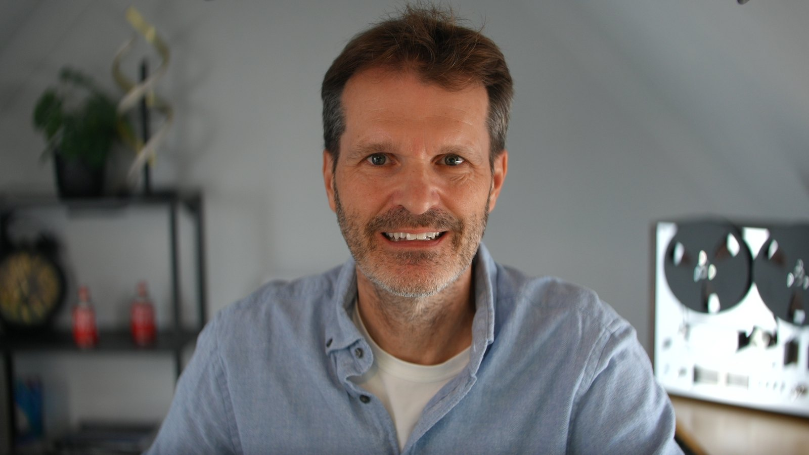
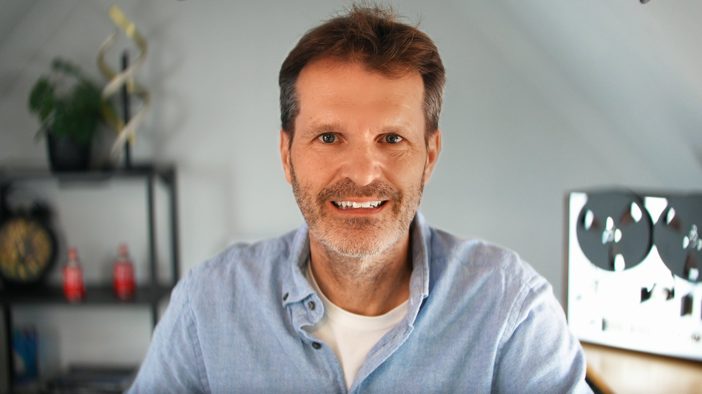

# KlarCam

Skin smoothing for webcams and OBS Studio that keeps the skin's texture. KlarCam
evens out skin and keeps pores, stubble and the shape of the face. It adds a virtual
key light computed from the 3D shape of your face, sets your exposure and the
background's separately, and corrects skin tone on the vectorscope's skin line.
Everything runs locally on your graphics card. Windows 10 and 11.

[Website](https://klarcam.com) ·
[Download](#download) ·
[OBS quick start](docs/quick-start-obs.md) ·
[App quick start](docs/quick-start-app.md) ·
[All controls](docs/parameters.md) ·
[Troubleshooting](docs/troubleshooting.md) ·
[Feedback](#feedback-and-support)

| Camera | KlarCam |
|---|---|
|  |  |

The same frame, once straight from the camera and once through KlarCam.

## What it does

- **Skin, only skin.** A face tracker with 468 points finds your face. The smoothing
  evens out the skin and leaves eyes, brows, lips and a beard alone. A share of the
  finest texture always goes back in, so pores and stubble stay. No reshaping, no
  bigger eyes, no make-up.
- **Light.** A virtual key light shaped by the 3D form of your face. It goes to the
  side your room's light comes from, measured once and then locked, so it never
  jumps sides during a stream.
- **Exposure.** Exposure for the whole frame, an optional automatic that holds your
  face at a target level, a soft face light like a lamp close to your face, and the
  background (everything outside you) on its own slider.
- **Skin tone.** Corrections on a Rec.709 vectorscope with the skin tone line as the
  reference: outliers move toward the line, the natural spread stays.
- **Eyes and teeth.** Sharper eyes, brighter eye whites, catchlight removal, teeth
  whitening.
- **Color.** Three bundled LUTs (reduce red skin, reduce yellow skin, contrast look)
  and your own `.cube` file, each on the face skin, the person or the whole frame,
  plus a film look.
- **Looks.** Two built-in presets, Natural and Stream. The app adds three slots of
  your own.
- **Measurable.** A built-in vectorscope, a measurement report of the live frame and
  debug views.
- **Local.** Your GPU does all the work. No image leaves your computer, and the
  license key is checked offline.

## Two ways to use it

| | KlarCam app | Filter for OBS Studio |
|---|---|---|
| For | Zoom, Microsoft Teams, Google Meet in Chrome or Edge, and other apps that use a camera | Streaming and recording with OBS Studio |
| How | The app reads your camera and sends the processed picture to the virtual camera **KlarCam**. Pick that camera in your call app. | Add the effect filter **KlarCam** to your camera source. |
| Installer | `KlarCam-Setup-0.4.0.exe`, which can also install the filter for OBS Studio | `KlarCam-Filter-Setup-0.4.0.exe`, or the full setup |
| Start here | [App quick start](docs/quick-start-app.md) | [OBS quick start](docs/quick-start-obs.md) |

Both run the same processing with the same controls, and one license key covers
both.

## Download

| File | Installs | Get it |
|---|---|---|
| `KlarCam-Setup-0.4.0.exe` (about 35 MB) | The app with the virtual camera, optionally the filter for OBS Studio | [GitHub release](https://github.com/klarcam/klarcam/releases/latest) or [klarcam.com](https://klarcam.com/download/KlarCam-Setup-0.4.0.exe) (the same file) |
| `KlarCam-Filter-Setup-0.4.0.exe` (about 19 MB) | Only the filter for OBS Studio | [GitHub release](https://github.com/klarcam/klarcam/releases/latest) |

Install one of the two: the app setup already includes the filter for OBS Studio, and
the filter setup does not install while the KlarCam app is installed.

The release notes list the SHA-256 of each file. To check a download, run this in
PowerShell in your Downloads folder and compare the result:

```powershell
Get-FileHash .\KlarCam-Setup-0.4.0.exe
```

The installers are not code-signed yet. Windows SmartScreen may therefore show
"Windows protected your PC". **More info** shows the file name and a **Run anyway**
button. Check the SHA-256 first.

## System requirements

- Windows 10 or 11, 64-bit.
- A graphics card with Direct3D 12: NVIDIA, AMD or Intel. KlarCam renders the
  picture with Direct3D 11 and runs the face tracking on DirectML, which needs
  Direct3D 12.
- For the filter: OBS Studio 33 or newer, with Direct3D 11 as its renderer (OBS's
  default on Windows).
- A camera Windows sees: a webcam, an HDMI capture card, or a software camera such
  as NVIDIA Broadcast or OBS Virtual Camera. 1080p or more works best.
- Both setups install for your Windows user and need no admin rights.

## Install

### The app, with the virtual camera

1. Run `KlarCam-Setup-0.4.0.exe`. It installs KlarCam for your Windows user in
   `%LOCALAPPDATA%\Programs\KlarCam`.
2. If OBS Studio is installed, the setup offers **Install the filter for OBS Studio
   (OBS 33 or newer; close OBS first)**. Close OBS before you go on. With that box
   ticked, the app setup also replaces a filter-only install (**KlarCam Filter**).
3. Start KlarCam. It opens your camera (the one you used last, or the first one it
   finds) and registers the virtual camera **KlarCam** for your Windows user.
4. In Zoom, Teams, Meet or any other app, choose the camera **KlarCam**. KlarCam has
   to run for that: closing its window hides it to the tray, and the camera keeps
   working.

### Only the filter for OBS Studio

1. Close OBS Studio.
2. Run `KlarCam-Filter-Setup-0.4.0.exe`. It installs the filter to
   `%ProgramData%\obs-studio\plugins\klarcam`, and nothing else: no app, no virtual
   camera. OBS Studio must be installed.
3. Start OBS and add the filter to your camera: [OBS quick start](docs/quick-start-obs.md).

To move from the filter setup to the app later, run the app setup with the filter for
OBS Studio ticked: it replaces **KlarCam Filter**. To go the other way, uninstall
**KlarCam** first, then run the filter setup.

### Update

Close OBS and run the new setup of the kind you have: it installs over the old
version. Your scenes keep their KlarCam filters and settings, and your key stays.

### Uninstall

Windows Settings > Apps > Installed apps, then **KlarCam** (the app setup) or
**KlarCam Filter** (the filter setup) > Uninstall. Your settings and your license key
in `%APPDATA%\KlarCam` stay, so a later install picks them up.

## Trial and license

- **Trial:** everything works for 14 days from the first start. The trial runs once:
  reinstalling, updating, a new major version or removing a key do not restart it.
  After that, the camera picture passes through unchanged until you enter a key.
- **Buy:** a one-time purchase at [klarcam.com](https://klarcam.com), €49, VAT
  included where applicable. No subscription. Payment runs through Stripe; the
  seller is Stripe's merchant of record "Sold through Link".
- **What a key covers:** the app and the filter in OBS for KlarCam 1, that is every
  0.x and 1.x release, with no time limit. A later major version (2.0 and up) is a
  separate purchase at the regular price; there is no upgrade discount.
- **Enter the key:** in the app under **Status > License**: paste it and click
  **Activate**. In OBS: the filter's **License key** field. The key is stored in
  `%APPDATA%\KlarCam` and works for both.
- **Lost your key?** [klarcam.com/key](https://klarcam.com/key) sends it again.
- **Terms:** [klarcam.com/terms](https://klarcam.com/terms). The English version is
  binding.

## Documentation

- [Quick start: OBS Studio](docs/quick-start-obs.md)
- [Quick start: the KlarCam app](docs/quick-start-app.md)
- [Every control explained](docs/parameters.md), the filter in OBS first, then the app
- [Troubleshooting](docs/troubleshooting.md)

## Feedback and support

- Found a bug, missing a feature, or have a question? [Open an issue](https://github.com/klarcam/klarcam/issues/new/choose).
  The forms ask for what helps: Windows version, GPU and driver, OBS version, KlarCam
  version and the status lines.
- Issues are public. **Never post your license key or your e-mail address.**
- Questions about a purchase, an invoice or your key: hello@klarcam.com.
- No GitHub account? Use the form at [klarcam.com/feedback](https://klarcam.com/feedback).

## About this repository

This repository holds KlarCam's user documentation and installers and collects
feedback. It also holds, in [klarcam-host](klarcam-host), the source code of the
filter host for OBS Studio (`klarcam.dll`): free software under the GNU General Public
License, version 2 or later. The filter host hands each frame to the KlarCam engine,
a separate program. The rest of KlarCam, the engine included, is proprietary
software, and its source code is not public; see [LICENSE.md](LICENSE.md) and the
[third-party notices](THIRD_PARTY_NOTICES.md).

KlarCam is third-party software. It is not part of OBS Studio and is not made by,
affiliated with or endorsed by the OBS Project; please report KlarCam problems here,
not to OBS. Zoom, Microsoft Teams, Google Meet and the other programs named here
appear only to say what KlarCam works with, and KlarCam is not affiliated with their
makers either.
